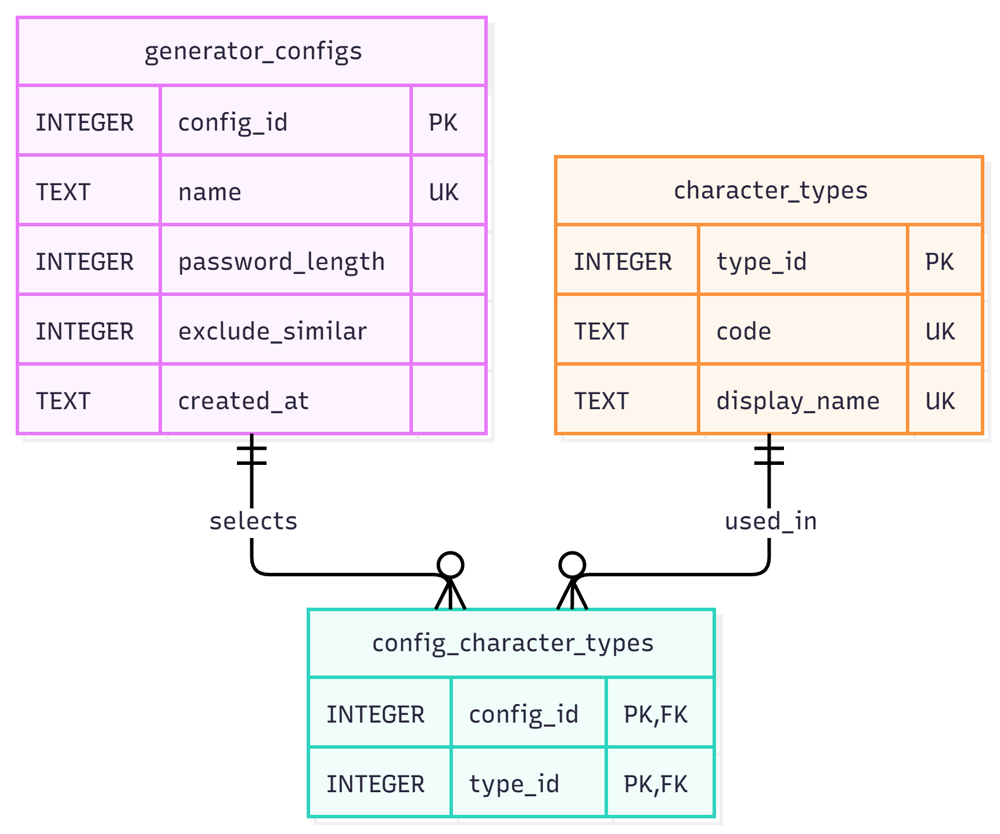

# Процесс проектирования и нормализации базы данных

## 1. Предметная область и границы модели

Репозиторий содержит браузерный генератор сложных паролей, а не систему управления задачами из примера лабораторной работы. По [техническому заданию](../docs/technical-specification.md) приложение хранит только настройки: длину от 6 до 128 символов, четыре выбранных типа символов и признак исключения похожих символов. Пароль создаётся в памяти страницы и не записывается ни в локальное хранилище, ни на сервер. Поэтому сущности `Users`, `Tasks` и `Projects` из учебного примера к этому приложению не относятся.

Реляционная схема ниже — результат проектирования для лабораторной работы. Текущая веб-страница по-прежнему использует `localStorage` и не подключается к SQLite. Схема описывает только допустимые конфигурации и справочник типов символов; таблицы паролей, истории генерации, учётных записей и содержимого буфера обмена отсутствуют.

Сущности:

1. `generator_configs` — именованная конфигурация: длина и опция исключения похожих символов.
2. `character_types` — четыре допустимых типа символов с кодами, соответствующими `script.js`.
3. `config_character_types` — выбранные типы для каждой конфигурации.

Связь `generator_configs` ↔ `character_types` имеет кратность M:N. Каждая строка таблицы связей относится ровно к одной конфигурации и одному типу. На уровне приложения конфигурация должна иметь минимум один тип; обычные ограничения SQLite не позволяют проверить это при создании строки до вставки её связей, поэтому при записи конфигурации это условие проверяется приложением в одной транзакции.

## 2. Исходная денормализованная структура

Плохой вариант: `Configs_Flat(config_id, name, password_length, exclude_similar, type_codes, type_names)`, где `type_codes = 'lowercase,uppercase,digits'`, а `type_names` содержит такой же список названий. Списки в одной ячейке нарушают атомарность; название типа повторяется во всех конфигурациях. Изменение названия потребует обновить много строк, а удаление последней конфигурации с типом уничтожит его описание.

## 3. Первая нормальная форма (1NF)

Разделяем списки на атомарные строки: `Configs_1NF(config_id, name, password_length, exclude_similar, type_code, type_name)`. Одна строка теперь означает выбор одного типа одной конфигурацией. Её естественный ключ — `(config_id, type_code)`. Повторяющихся групп и значений-списков нет, но параметры конфигурации дублируются для каждого выбранного типа.

## 4. Вторая нормальная форма (2NF)

У составного ключа в `Configs_1NF` есть частичные зависимости:

- `config_id → name, password_length, exclude_similar`;
- `type_code → type_name`.

Чтобы каждый неключевой атрибут зависел от *всего* ключа, выделяем `generator_configs(config_id, name, password_length, exclude_similar, created_at)` и `character_types(type_id, code, display_name)`. В таблице `config_character_types(config_id, type_id)` остаётся только пара внешних ключей. Её составной первичный ключ исключает дубликаты.

## 5. Третья нормальная форма (3NF)

Проверяем транзитивные зависимости. В упрощённом, но неверном варианте с одним типом на конфигурацию строка `generator_configs(config_id, ..., type_code, type_name)` имела бы зависимость `config_id → type_code → type_name`: название зависело бы от неключевого `type_code`, а не непосредственно от `config_id`. В итоговой схеме название хранится только в `character_types`; выбор типов вынесен в `config_character_types`, где неключевых атрибутов нет. Атрибуты `generator_configs` зависят от `config_id`, атрибуты `character_types` — от `type_id` (а `code` — альтернативный уникальный ключ). Никакой неключевой атрибут не зависит от другого неключевого атрибута. Все три таблицы находятся в 3NF.

| Таблица | Первичный ключ | Внешние ключи | Остальные ограничения |
| --- | --- | --- | --- |
| `generator_configs` | `config_id` | — | `name` уникально; `password_length` 6–128; `exclude_similar` 0/1 |
| `character_types` | `type_id` | — | `code` и `display_name` уникальны; `code` — один из четырёх типов |
| `config_character_types` | `(config_id, type_id)` | `config_id`, `type_id` | запрет повторной пары |

Удаление конфигурации удаляет её связи (`CASCADE`), но не справочник типов. Удаление используемого типа запрещено (`RESTRICT`). Внешние ключи SQLite включаются через `PRAGMA foreign_keys = ON` для каждого соединения. Индекс по `type_id` ускоряет обратный поиск конфигураций, индекс по `created_at` — вывод конфигураций по времени; уникальные поля индексируются SQLite автоматически.

## 6. Финальная ER-диаграмма



Векторная версия: [er_diagram.svg](../docs/database/er_diagram.svg). Исходник для редактирования в [diagrams.net](https://app.diagrams.net/): [er_diagram.drawio](../docs/database/er_diagram.drawio). PNG и SVG экспортированы в diagrams.net.

## 7. Запуск и проверка

```powershell
python -c "import sqlite3; c=sqlite3.connect('example.db'); c.executescript(open('database/schema.sql', encoding='utf-8').read()); c.executescript(open('database/seed_data.sql', encoding='utf-8').read()); print(c.execute('PRAGMA foreign_key_check').fetchall()); c.close()"
python -m unittest discover -s tests -p test_database.py
```

`example.db` — только локальный результат проверки и не должен попадать в Git. Тесты используют БД в памяти. Реальные пароли не входят даже в тестовые данные.
