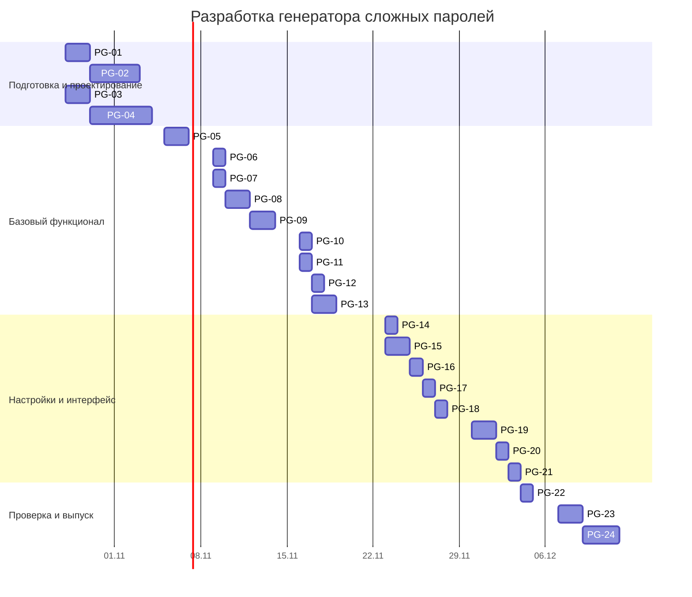

<!-- generated-from: docs/backlog.json -->
# План проекта «Генератор сложных паролей»

План составлен по [техническому заданию](https://github.com/Tralalaca/password-generator-srs/blob/main/docs/technical-specification.md). Приложение работает в браузере: серверная логика и база данных для паролей не нужны. Один исполнитель выполняет несколько ролей; основная роль каждой задачи указана в её метке.

## 1. Участник и роли

| Роль | Исполнитель | Обязанности |
| --- | --- | --- |
| Менеджер проекта | @Tralalaca | Сроки, зависимости, контроль этапов |
| Дизайнер | @Tralalaca | Макеты и состояния интерфейса |
| Frontend-разработчик | @Tralalaca | Браузерное приложение и настройка генерации |
| QA-инженер | @Tralalaca | Проверки требований, безопасности и выпуска |

Backend-разработка не запланирована, поскольку по ТЗ пароль создаётся только в браузере и не передаётся на сервер.

## 2. Беклог и контрольные точки

**Всего задач:** 24. **Оценка:** 178 ч. **Период:** 28.10.2026–11.12.2026. Сложность: большая — 4, средняя — 12, малая — 8.

В Project входят только 24 детализированные задачи PG-01–PG-24. Существующие Issues #8–#14 сохраняются как требования верхнего уровня; старые Issues #2–#7 относятся к прежней теме репозитория и в этот план не входят.

| Контрольная точка | Срок | Результат |
| --- | --- | --- |
| Подготовка и проектирование | 2026-11-04 | Структура проекта, технические решения и макеты интерфейса |
| Базовый функционал | 2026-11-20 | Генерация, настройка символов, копирование и оценка стойкости |
| Настройки и интерфейс | 2026-12-03 | Сохранение настроек, русские сообщения, адаптивность и доступность |
| Проверка и выпуск | 2026-12-11 | Проверки безопасности, автоматические тесты и выпуск версии 1.0 |

| Issue | Задача | Начало | Окончание | Основная роль | Зависит от |
| --- | --- | --- | --- | --- | --- |
| [#15](https://github.com/Tralalaca/password-generator-srs/issues/15) | Подготовить структуру веб-приложения и команды разработки | 2026-10-28 | 2026-10-29 | project-manager | — |
| [#16](https://github.com/Tralalaca/password-generator-srs/issues/16) | Зафиксировать архитектуру и правила работы с паролем | 2026-10-30 | 2026-11-02 | project-manager | #15 |
| [#17](https://github.com/Tralalaca/password-generator-srs/issues/17) | Подготовить макет одного экрана для ширины 360 пикселей | 2026-10-28 | 2026-10-29 | designer | — |
| [#18](https://github.com/Tralalaca/password-generator-srs/issues/18) | Описать визуальные состояния и текстовые сообщения интерфейса | 2026-10-30 | 2026-11-03 | designer | #17 |
| [#19](https://github.com/Tralalaca/password-generator-srs/issues/19) | Сверстать основную страницу генератора | 2026-11-05 | 2026-11-06 | frontend | #15, #18 |
| [#20](https://github.com/Tralalaca/password-generator-srs/issues/20) | Добавить поле длины с границами от 6 до 128 | 2026-11-09 | 2026-11-09 | frontend | #19 |
| [#21](https://github.com/Tralalaca/password-generator-srs/issues/21) | Добавить четыре переключателя наборов символов | 2026-11-09 | 2026-11-09 | frontend | #19 |
| [#22](https://github.com/Tralalaca/password-generator-srs/issues/22) | Реализовать криптографически стойкий выбор символов | 2026-11-10 | 2026-11-11 | frontend | #16 |
| [#23](https://github.com/Tralalaca/password-generator-srs/issues/23) | Собрать пароль заданной длины с покрытием выбранных наборов | 2026-11-12 | 2026-11-13 | frontend | #21, #22 |
| [#24](https://github.com/Tralalaca/password-generator-srs/issues/24) | Обработать неверную длину и отсутствие наборов | 2026-11-16 | 2026-11-16 | frontend | #20, #21, #23 |
| [#25](https://github.com/Tralalaca/password-generator-srs/issues/25) | Добавить исключение похожих символов | 2026-11-16 | 2026-11-16 | frontend | #23 |
| [#26](https://github.com/Tralalaca/password-generator-srs/issues/26) | Реализовать копирование показанного пароля | 2026-11-17 | 2026-11-17 | frontend | #19, #23 |
| [#27](https://github.com/Tralalaca/password-generator-srs/issues/27) | Вычислить ориентировочную стойкость пароля | 2026-11-17 | 2026-11-18 | frontend | #23, #25 |
| [#28](https://github.com/Tralalaca/password-generator-srs/issues/28) | Показать рекомендации для слабого и среднего пароля | 2026-11-23 | 2026-11-23 | frontend | #27 |
| [#29](https://github.com/Tralalaca/password-generator-srs/issues/29) | Определить схему настроек и значения по умолчанию | 2026-11-23 | 2026-11-24 | frontend | #20, #21, #25 |
| [#30](https://github.com/Tralalaca/password-generator-srs/issues/30) | Сохранять настройки после каждого изменения | 2026-11-25 | 2026-11-25 | frontend | #29 |
| [#31](https://github.com/Tralalaca/password-generator-srs/issues/31) | Восстанавливать только допустимые сохранённые настройки | 2026-11-26 | 2026-11-26 | frontend | #30 |
| [#32](https://github.com/Tralalaca/password-generator-srs/issues/32) | Обработать недоступное локальное хранилище | 2026-11-27 | 2026-11-27 | frontend | #31 |
| [#33](https://github.com/Tralalaca/password-generator-srs/issues/33) | Свести русскоязычные сообщения и состояния в интерфейсе | 2026-11-30 | 2026-12-01 | frontend | #24, #26, #28, #32 |
| [#34](https://github.com/Tralalaca/password-generator-srs/issues/34) | Проверить адаптивную компоновку от 360 пикселей | 2026-12-02 | 2026-12-02 | frontend | #33 |
| [#35](https://github.com/Tralalaca/password-generator-srs/issues/35) | Обеспечить клавиатурное управление и видимые подписи | 2026-12-03 | 2026-12-03 | frontend | #33, #34 |
| [#36](https://github.com/Tralalaca/password-generator-srs/issues/36) | Проверить отсутствие утечек и сохранения пароля | 2026-12-04 | 2026-12-04 | qa | #23, #30, #35 |
| [#37](https://github.com/Tralalaca/password-generator-srs/issues/37) | Написать автоматические проверки требований генератора | 2026-12-07 | 2026-12-08 | qa | #27, #32, #35 |
| [#38](https://github.com/Tralalaca/password-generator-srs/issues/38) | Провести приёмку в браузерах и подготовить выпуск 1.0 | 2026-12-09 | 2026-12-11 | qa | #36, #37 |

## 3. Диаграмма Ганта

[Открыть Roadmap](https://github.com/users/Tralalaca/projects/1/views/2)

Даты начала и окончания каждого Issue также заданы в полях Project. Зависимости перечислены в Issues и оформлены связями «Blocked by».

## 4. Проверка результата

Выпуск завершён, когда реализованы критерии ТЗ, пройдены автоматические проверки, подтверждены отсутствие сохранения и передачи пароля, а браузерная приёмка и ограничения зафиксированы в README.
